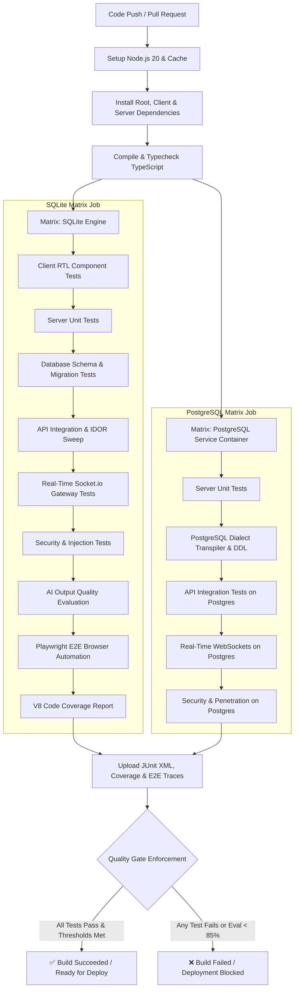

# AmitAstro CI/CD Pipeline & Quality Gate Architecture

This document describes the continuous integration, continuous delivery, and automated testing architecture implemented for the **AmitAstro** consultation platform.

---

## 1. Pipeline Overview & Mermaid Architecture

The CI/CD pipeline runs on GitHub Actions on every pull request and push to the `main` branch. It executes a dual-engine test matrix validating application behavior against both an embedded SQLite engine and a real PostgreSQL service container.



---

## 2. Automated Pipeline Stages

### Stage 1: Build & Static Validation
- Compiles client (Vite + React 19 + TypeScript) and backend (Express + Node + TypeScript).
- Fails immediately on type mismatches, syntax errors, or unresolvable imports.

### Stage 2: Dual-Engine Database Validation
- **SQLite Job**: Validates rapid ephemeral test runs simulating local developer workflows.
- **PostgreSQL Job**: Spins up a native `postgres:16-alpine` service container with automated health checking (`pg_isready`). Executes all 18 table migrations, transactional rollbacks, and parameter transpilation (`?` -> `$1..$n`).

### Stage 3: Feature & Security Regression Sweep
- Supertest exercises all 38 REST endpoints verifying authentication, role-based access control, tenant data isolation (IDOR), slot booking math, manual UPI/UTR payment approvals, and Family 360 subscription limits.
- Security tests inject SQL tautologies, stacked queries, stored XSS script tags, forged JWTs, and verify double-submit CSRF cookie enforcement.

### Stage 4: Playwright End-to-End Browser Journeys
- Launches real headless Chromium instances with network interception.
- Tests visitors signing up, booking across timezones, triggering the 5-minute trial countdown, submitting UPI references, and toggling Hindi/English language dictionaries.

### Stage 5: AI Output Quality Evaluation Gate
- Evaluates Gemini-generated blog articles and translations across 30 seed scenarios.
- Measures Devanagari script purity, schema conformance, safety violations, and LLM-as-a-judge rubric scores.
- **Enforcement Rule**: If the composite quality pass rate drops below **85%**, the entire build is failed.

---

## 3. Nightly Deep Audit Workflow (`nightly.yml`)

In addition to PR checks, a nightly GitHub Actions workflow triggers at **02:00 UTC**:
- Runs the live AI evaluation harness against the actual Gemini 1.5/2.0 API using the repository secret `GEMINI_API_KEY`.
- Runs Autocannon performance benchmarks measuring p50/p95/p99 latency and throughput.
- Runs Stryker mutation testing on critical security modules.
- Generates long-term quality trends and publishes reports to GitHub Step Summaries.

---

## 4. Pre-Commit Fast Hook

Developers can ensure local commits never break the remote pipeline by running the fast pre-commit check:

```bash
npm run precommit
```

This runs pure unit tests, rate-limiter boundaries, and security penetration checks in under 5 seconds.
