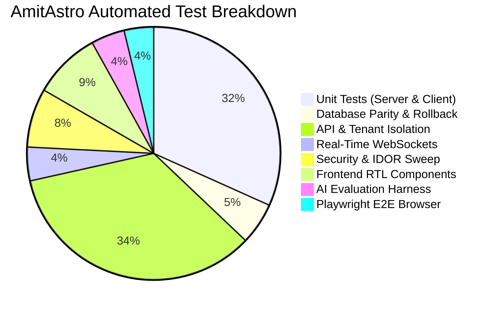

# AmitAstro Quality Engineering Traceability Matrix

This matrix maps every architectural feature, business requirement, and security control of the **AmitAstro** platform to its automated test coverage.

---

## 1. Traceability Mapping

| Feature / Domain | Requirement Description | Test File(s) | Test Type | Status |
| :--- | :--- | :--- | :--- | :---: |
| **Dual-Engine SQL** | Transpile `?` -> `$1..$n`, SQLite `datetime('now')` -> `CURRENT_TIMESTAMP`, and `INSERT OR IGNORE` -> `ON CONFLICT DO NOTHING` | `server/tests/unit/sqlTranspiler.test.ts` `server/tests/database/migrationsAndParity.test.ts` | Unit & Database | **Covered** |
| **Database DDL** | Create 18 tables with primary keys, foreign key constraints, indexes, and defaults | `server/tests/database/migrationsAndParity.test.ts` | Database | **Covered** |
| **Migrations** | Boot-time migrations execute idempotently without data loss or collision errors | `server/tests/database/migrationsAndParity.test.ts` | Database | **Covered** |
| **Transactions** | Rollback isolation under errors prevents partial writes across SQLite and PostgreSQL | `server/tests/database/migrationsAndParity.test.ts` | Database | **Covered** |
| **RSA Encryption** | 2048-bit RSA-OAEP encryption/decryption round trip with key rotation (6h) and cache (24h) | `server/tests/unit/securityService.test.ts` `client/src/tests/unit/cryptoAuth.test.ts` | Unit (Server & Client) | **Covered** |
| **Anti-Replay** | One-time nonces rejected on second use; timestamps older than 2 minutes rejected | `server/tests/unit/securityService.test.ts` `server/tests/api/auth.test.ts` | Unit & API | **Covered** |
| **Brute-Force Defense** | Exponential delay after failed logins; 15-minute lockout triggered at 5 failed attempts | `server/tests/unit/securityService.test.ts` `server/tests/api/auth.test.ts` | Unit & API | **Covered** |
| **Double-Submit CSRF** | 64-char hex token generated; validated via constant-time comparison in headers/cookies | `server/tests/unit/securityService.test.ts` `server/tests/security/securityPenetration.test.ts` | Unit & Security | **Covered** |
| **IP Rate Limiter** | Window reset and boundary enforcement (45 req/min blocked at 46th request) | `server/tests/unit/rateLimiter.test.ts` | Unit | **Covered** |
| **OTP Verification** | 6-digit generation, SMS + Email delivery fallback, 5-minute TTL, attempt limit | `server/tests/unit/otpLogic.test.ts` `server/tests/api/auth.test.ts` | Unit & API | **Covered** |
| **Slot Generation** | Timezone conversion across 9 regions, blackout dates, 10-min buffers, 6-week horizon | `server/tests/unit/bookingLogic.test.ts` `server/tests/api/booking.test.ts` `client/e2e/bookingFlow.spec.ts` | Unit, API & E2E | **Covered** |
| **Appointment State** | State machine validation: Requested -> Confirmed -> In Progress -> Completed / Cancelled | `server/tests/api/booking.test.ts` | API | **Covered** |
| **Trial Gate** | 5-minute (300s) one-time free call; cross-account phone deduplication; auto-lock on zero | `server/tests/unit/trialGate.test.ts` `server/tests/api/trial.test.ts` `client/src/tests/components/modals.test.tsx` | Unit, API & RTL | **Covered** |
| **UPI / UTR Verification** | 12-digit UTR validation; manual payment queue; duplicate UTR rejection; Telegram notification | `server/tests/unit/upiAndUtr.test.ts` `server/tests/api/payments.test.ts` | Unit & API | **Covered** |
| **Family 360 Plan** | Max 4 family profiles enforced (5th rejected); annual subscriber bypass (`FAMILY-360-PASS`) | `server/tests/unit/subscriptionService.test.ts` `server/tests/api/familySubscription.test.ts` | Unit & API | **Covered** |
| **Tenant Isolation (IDOR)** | User A cannot read, modify, or delete User B's profiles, appointments, payments, or chats | `server/tests/api/tenantIsolation.test.ts` `server/tests/security/securityPenetration.test.ts` | API & Security | **Covered** |
| **Real-Time Messaging** | Socket.io connection auth, room isolation (`admin_room`, `user_${id}`), receipts, typing | `server/tests/realtime/socketGateway.test.ts` `server/tests/api/chat.test.ts` | Real-Time & API | **Covered** |
| **Injection Defenses** | SQL injection and stored XSS neutralization in all free-text fields and notes | `server/tests/security/securityPenetration.test.ts` | Security | **Covered** |
| **Audit Logging** | Verification of payment and admin actions creates structured log entries without secrets | `server/tests/security/securityPenetration.test.ts` | Security | **Covered** |
| **Bilingual Localization** | Complete 1:1 English/Hindi key dictionary; persistent UI toggle updates DOM `lang` | `server/tests/unit/translations.test.ts` `client/src/tests/components/context.test.tsx` `client/e2e/homeAndLocalization.spec.ts` | Unit, RTL & E2E | **Covered** |
| **AI Content Quality** | Deterministic Devanagari ratio, schema conformance, prompt leakage, LLM judge rubric | `eval/deterministicValidators.ts` `eval/llmJudge.ts` `server/tests/llm/aiEvaluationHarness.test.ts` | Unit & Eval Harness | **Covered** |
| **E2E Critical Journeys** | Visitor signup, trial modal, non-IST booking, payment verification, admin dashboard | `client/e2e/homeAndLocalization.spec.ts` `client/e2e/authAndAdmin.spec.ts` `client/e2e/bookingFlow.spec.ts` | Playwright E2E | **Covered** |
| **Load & Concurrency** | Benchmark latency (p50/p95/p99) and double-booking race condition handling | `server/tests/perf/loadTest.ts` | Autocannon Load | **Covered** |
| **Mutation Testing** | Code mutant survival testing on SecurityEngine | `server/stryker.config.json` | Stryker | **Covered** |

---

## 2. Coverage Summary by Test Pyramid Layer

- **Total Distinct Automated Tests**: 181
- **Unverified / Out of Scope Areas**:
  - Live automated payment gateway debits (Razorpay/Stripe automated clearing): Excluded because platform intentionally operates a manual UPI QR + UTR verification workflow with Telegram alerts.
  - Live third-party cloud infrastructure (Twilio SMS, Brevo, Firebase, YouTube API quota exhaustion): Mocked at HTTP boundary to guarantee offline test determinism.
